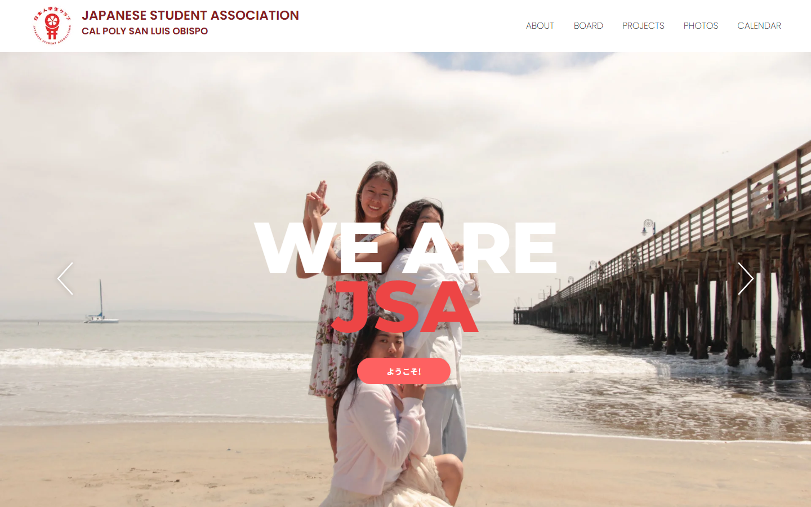

# Cal Poly JSA Website

The official website of the Japanese Student Association (JSA) at Cal Poly San Luis Obispo.

**Visit the site:** [jsacalpoly.org](https://jsacalpoly.org)  
**Design in Figma:** [Figma Design](https://www.figma.com/design/shOcawf7ftNzUNCOFnU6Is)



---

## About

JSA is a community for students who love Japanese culture, food, language and friendship, and everyone is welcome. This site is where members find out who we are, what we do and when we meet.

## What's on the site

| Page                 | What you'll find                                         |
| -------------------- | -------------------------------------------------------- |
| **Home** (`/`)       | An overview of JSA and some of our projects              |
| **About** (`/board`) | Who we are and what a year with JSA looks like           |
| **26-27**            | This year's board                                        |
| **Eras**             | Past boards and the history of the club                  |
| **Projects**         | Recurring meetups, big events and the Big-Little program |
| **Photos**           | Photo albums from our events                             |
| **Calendar**         | What's coming up                                         |
| **Links**            | One page with all of our important links                 |

## Get involved

- Follow us on Instagram: [@calpolyjsa](https://www.instagram.com/calpolyjsa)
- Email us: jsacalpoly@gmail.com
- Check the **Projects** and **Calendar** pages for upcoming meetups.

## Helping with the site

You don't need to be a developer to keep the site current. Most yearly updates (board members, photo albums, projects and calendar events) are edits to small data files, with no page code involved. See [Updating the content](docs/updating-content.md) and the [contributing steps](CONTRIBUTING.md).

---

## For developers

Everything below is technical: how the site is built, run, styled and deployed. It is a static site built with Astro and plain CSS, hosted on Cloudflare Workers.

### Tech stack

| Layer           | Choice                                    | Purpose                                                                                      |
| --------------- | ----------------------------------------- | -------------------------------------------------------------------------------------------- |
| Framework       | [Astro](https://astro.build)              | Builds static HTML from reusable components                                                  |
| Styling         | Plain CSS                                 | Design tokens as CSS custom properties; flexbox and grid for layout; component-scoped styles |
| Fonts           | Google Fonts                              | Loaded through font variables so they can be swapped in one place                            |
| Content         | Astro content collections (Markdown/JSON) | Board members, eras, photo events, calendar events and projects stored as data               |
| Images          | `astro:assets`                            | Resizes and compresses images at build time                                                  |
| Version control | GitHub (`jsacalpoly` organization)        | Pull-request workflow                                                                        |
| Hosting         | Cloudflare Workers (static assets)        | Builds on every push via Workers Builds; production deploys on merge to `main`               |

### Getting started

#### Requirements

- [Node.js](https://nodejs.org) (current LTS)
- npm (comes with Node)
- Git

#### Run locally

```bash
git clone https://github.com/jsacalpoly/jsa-calpoly.git
cd jsa-calpoly
npm install
npm run dev
```

The site runs at `http://localhost:4321` and reloads as you edit.

#### Commands

| Command            | What it does                                                      |
| ------------------ | ----------------------------------------------------------------- |
| `npm run dev`      | Start the local dev server                                        |
| `npm run build`    | Build the production site into `dist/`                            |
| `npm run preview`  | Serve the built site locally to check it before deploying         |
| `npx wrangler dev` | Preview the built site in Cloudflare's local runtime              |
| `npm run format`   | Format all files with Prettier                                    |
| `npm run lint`     | Check the code with ESLint (`npm run lint:fix` fixes what it can) |

---

### Developer docs

| Doc                                              | What's in it                                         |
| ------------------------------------------------ | ---------------------------------------------------- |
| [Contributing](CONTRIBUTING.md)                  | Branch and pull request workflow, checks before push |
| [Updating the content](docs/updating-content.md) | Board, photo albums, projects and calendar events    |
| [Project structure](docs/project-structure.md)   | Where everything lives                               |
| [Styling conventions](docs/styling.md)           | Design tokens and CSS rules                          |
| [Deployment](docs/deployment.md)                 | Cloudflare Workers setup                             |
| [Roadmap](docs/roadmap.md)                       | What's done and what's next                          |

---

## Contact

Lead developer: [Ethan Ikenaga](https://github.com/ethanikenaga) on GitHub
